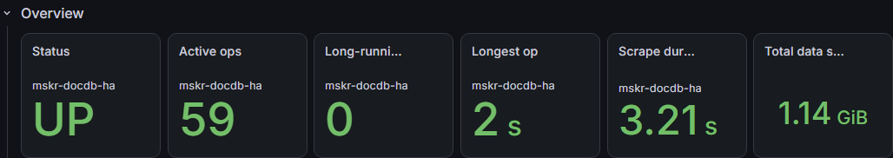
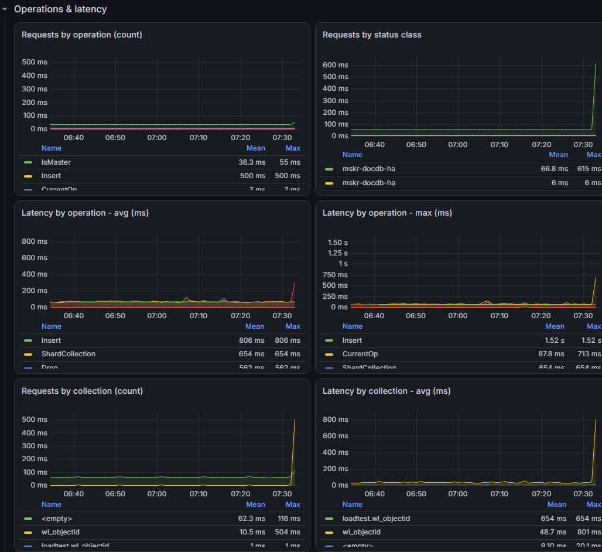
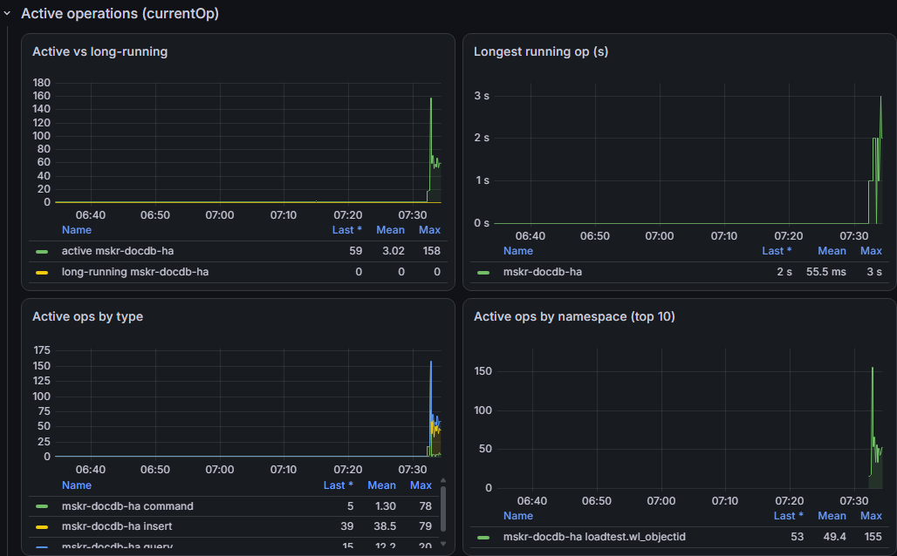
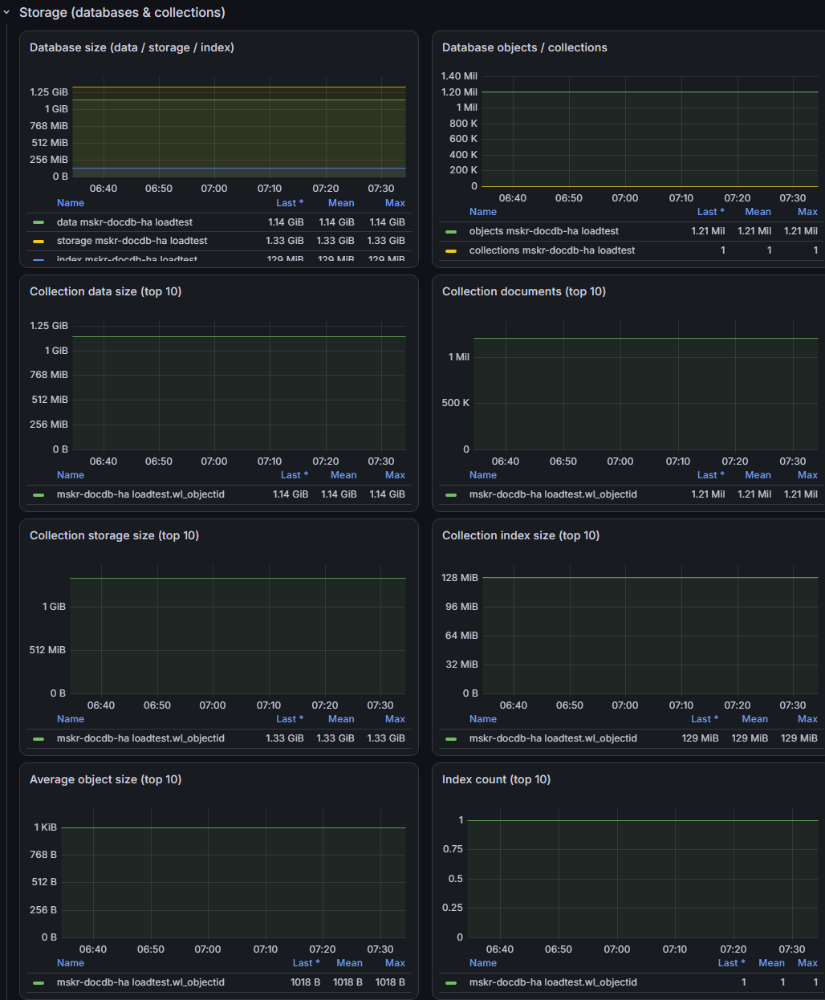
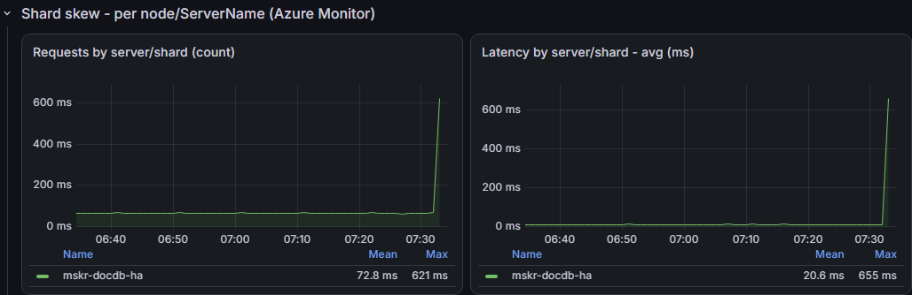
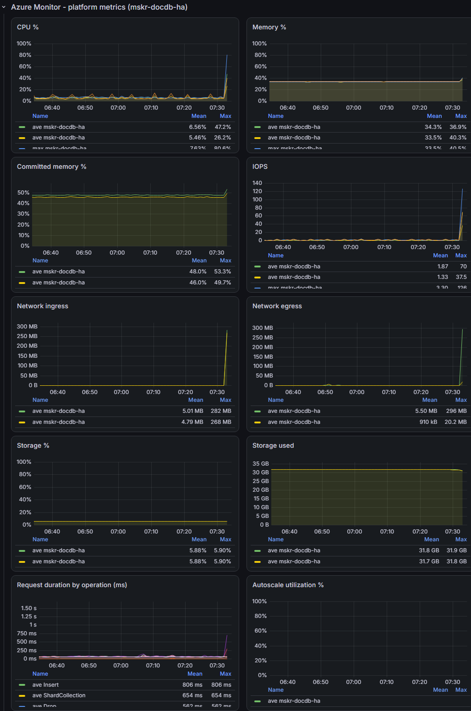
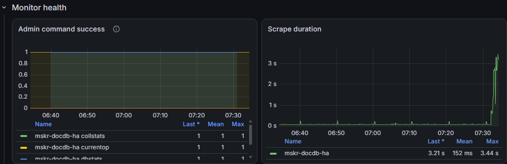

# DocumentDB 모니터링 구조 및 설정 가이드

대상: Azure DocumentDB(MongoDB vCore) 클러스터 `<doc-db-cluster-name>`.

## 목차

- [0. 요약](#0-요약)
- [1. 전체 구조](#1-전체-구조)
- [2. Azure Monitor workspace 구성](#2-azure-monitor-workspace-구성)
- [3. 포털 없는 수집 구성](#3-포털-없는-수집-구성)
- [4. Grafana Dashboard](#4-grafana-dashboard)
- [5. 메트릭 카탈로그](#5-메트릭-카탈로그)
- [6. 제한 사항](#6-제한-사항)

> **안내:** `<resource-group>`, `<doc-db-cluster-name>` 등은 자리표시자입니다. 명령이나 설정을 실행하기 전에 각 환경의 실제 값으로 변경합니다. 리소스 그룹이 다르면 수집기, DocumentDB, Grafana 각각의 값을 사용합니다.

## 0. 요약

**Azure Monitor workspace(AMW)**는 Prometheus 메트릭 저장소입니다. 수집기가 Managed Identity를 사용해 기본 DCE/DCR을 통해 메트릭을 전송하고, Grafana는 PromQL 엔드포인트로 조회합니다.

**별도 포털 없는 수집:** Azure Monitor 플랫폼 지표는 수집기 없이 Grafana의 Azure Monitor 데이터 소스로 조회할 수 있습니다. DB 내부 지표를 수집하려면 별도 exporter와 Prometheus agent가 필요합니다. 타겟 설정은 별도 UI 대신 Key Vault 시크릿과 태그로 관리할 수 있습니다.

**Grafana:** 기존 Azure Managed Grafana에 Azure Monitor 및 AMW Prometheus 데이터 소스를 준비하고 대시보드 JSON을 가져옵니다.

> **저장소 범위:** 애플리케이션 소스는 이 저장소에 포함하지 않습니다. 따라서 이 저장소만으로 exporter/수집기 이미지를 빌드하거나 수집기를 배포할 수 없습니다. 기존 수집기를 사용하거나 별도로 검토된 앱 소스와 배포 방법을 준비해야 합니다. Terraform은 AMW와 RBAC를 다루며 수집기를 만들지 않습니다.

## 1. 전체 구조

### A. DB 내부 지표 — Prometheus 경로

<!-- markdownlint-disable MD033 -->
 **Azure DocumentDB** → MongoDB 조회 →  **수집기: exporter + Prometheus agent** → remote_write →  **Azure Monitor workspace** → PromQL 조회 결과 →  **Grafana**

 **Azure Key Vault → 수집기:** 수집기가 Managed Identity를 사용해 연결 문자열과 수집 설정을 읽습니다. Private Endpoint 사용 시 해당 DNS와 네트워크 경로가 필요합니다.

### B. 플랫폼 지표 — Azure Monitor 직접 조회

 **Azure DocumentDB** → 지표 게시 →  **Azure Monitor 지표** → 조회 결과 →  **Grafana**
<!-- markdownlint-enable MD033 -->

플랫폼 지표 경로에는 별도의 DB 수집기가 필요하지 않습니다. 화살표는 데이터 전달 방향을 나타냅니다. 아이콘 출처: [Microsoft Azure 아키텍처 아이콘](https://learn.microsoft.com/azure/architecture/icons/). AMW에는 Azure Monitor 공통 아이콘을 사용했습니다.

| 구성 요소 | 이름 / 위치 | 역할 |
| --- | --- | --- |
| DocumentDB | `<doc-db-cluster-name>` / `<doc-db-resource-group>` | 모니터링 대상 |
| 수집기 | `<collector-app-name>` / `<resource-group>` | exporter와 Prometheus agent. **별도 준비 필요** |
| 접속 정보 저장소 | `<key-vault-name>` | 연결 문자열 및 수집 설정 |
| 메트릭 저장소 | `<amw-name>` | Prometheus remote_write 수신 및 PromQL 조회 |
| 시각화 | `<grafana-name>` / `<grafana-resource-group>` | 대시보드 |

| 경로 | 지표 | Grafana 데이터 소스 |
| --- | --- | --- |
| 플랫폼 지표 | CPU, 메모리, IOPS, 스토리지, 네트워크, 요청·지연 | Azure Monitor |
| DB 내부 지표 | currentOp, DB·컬렉션 크기, 문서 수, 인덱스 | AMW Prometheus |

## 2. Azure Monitor workspace 구성

### 2-1. Azure CLI — AMW 생성과 remote_write URL

사전에 Azure CLI로 로그인하고 대상 구독을 선택합니다. 기존 AMW를 사용하는 경우 생성 단계는 생략하고 기존 리소스를 조회합니다.

```powershell
$rg = '<resource-group>'
$amwName = '<amw-name>'
az monitor account create -g $rg -n $amwName -l '<azure-region>'
$amw = az monitor account show -g $rg -n $amwName -o json | ConvertFrom-Json

$dcrId = $amw.defaultIngestionSettings.dataCollectionRuleResourceId
$dceId = $amw.defaultIngestionSettings.dataCollectionEndpointResourceId
$dcrImm = az rest --method get --url "https://management.azure.com$($dcrId)?api-version=2022-06-01" --query properties.immutableId -o tsv
$dceUrl = az rest --method get --url "https://management.azure.com$($dceId)?api-version=2022-06-01" --query properties.metricsIngestion.endpoint -o tsv
$remoteWrite = "$dceUrl/dataCollectionRules/$dcrImm/streams/Microsoft-PrometheusMetrics/api/v1/write?api-version=2023-04-24"
$amw.metrics.prometheusQueryEndpoint
```

### 2-2. 수집기와 Grafana 읽기 권한

수집기 Managed Identity에 DCR 범위 **Monitoring Metrics Publisher**를, Grafana Managed Identity에 AMW 범위 **Monitoring Data Reader**와 DocumentDB 리소스 그룹 범위 **Monitoring Reader**를 부여합니다. 역할 할당 권한과 전파 시간이 필요합니다.

```powershell
az role assignment create --assignee-object-id '<collector-managed-identity-principal-id>' `
  --assignee-principal-type ServicePrincipal --role 'Monitoring Metrics Publisher' --scope $dcrId
az role assignment create --assignee-object-id '<grafana-managed-identity-principal-id>' `
  --assignee-principal-type ServicePrincipal --role 'Monitoring Data Reader' --scope $amw.id
az role assignment create --assignee-object-id '<grafana-managed-identity-principal-id>' `
  --assignee-principal-type ServicePrincipal --role 'Monitoring Reader' `
  --scope '/subscriptions/<subscription-id>/resourceGroups/<doc-db-resource-group>'
```

기존 역할 할당이 있다면 중복 생성하지 않고 확인합니다. Prometheus 데이터 소스는 AMW 쿼리 엔드포인트와 Managed Identity 인증을 사용합니다.

### 2-3. Prometheus agent 설정 예시

```yaml
remote_write:
  - url: "<remote-write-url>"
    azuread:
      cloud: AzurePublic
      managed_identity:
        client_id: "<collector-managed-identity-client-id>"
    write_relabel_configs:
      - source_labels: [__name__]
        regex: "docdb_.*|up"
        action: keep
```

이 설정은 별도 수집기의 일부이며, 이 저장소는 exporter나 agent 이미지를 제공하지 않습니다.

### 2-4. 수집 확인

```powershell
$t = az account get-access-token --resource https://prometheus.monitor.azure.com --query accessToken -o tsv
Invoke-RestMethod -Headers @{ Authorization = "Bearer $t" } `
  -Uri "$($amw.metrics.prometheusQueryEndpoint)/api/v1/query?query=docdb_up"
```

AMW 샘플량은 대상 수, 시리즈 수와 수집 주기에 영향을 받습니다. 시험 후에는 부하와 비용을 고려해 주기를 조정하세요.

### 2-5. Terraform

[terraform](terraform/)은 **기존 수집기 및 Grafana 관리 ID**를 입력받아 AMW와 세 개의 역할 할당을 관리합니다. 리소스 그룹은 기존 항목을 사용합니다. 수집기, Key Vault, Grafana 자체는 생성하지 않습니다.

1. [변수 예시](terraform/terraform.tfvars.example.json)를 별도 파일로 복사해 환경에 맞게 작성합니다.
2. 기존 AMW나 역할 할당이 있다면 Terraform state로 가져온 후 plan을 확인합니다. 기존 리소스를 중복 생성하지 마세요.
3. 선택적 CAF 이름 기능은 대상 provider 버전에서 지원 여부를 확인한 후 사용합니다. 기본값은 `false`입니다.

```powershell
Set-Location terraform
terraform init
terraform fmt -check
terraform validate
terraform plan -var-file='<private-tfvars-file>' -out=main.tfplan
# 검토 후에만 적용
terraform apply main.tfplan
```

Terraform state와 plan에는 민감한 값이 들어갈 수 있습니다. 원격 backend 암호화와 접근 제어를 적용하세요. 실제 배포 전 네트워크 정책과 RBAC를 검토해야 합니다. 이 저장소의 Terraform 코드는 아직 `terraform validate` 및 실제 배포로 검증되지 않았습니다.

Terraform 출력의 DCR/DCE 리소스 ID는 immutable ID 또는 수집 URL이 아닙니다. 배포 후 2-1절의 조회로 remote_write URL을 구성합니다.

## 3. 포털 없는 수집 구성

### 3-1. 수집 방식 선택

| 지표 | 별도 수집기 | 구성 |
| --- | --- | --- |
| CPU, 메모리, IOPS, 스토리지, 네트워크, 요청·지연 | 불필요 | Grafana Azure Monitor 데이터 소스 및 읽기 권한 |
| currentOp, DB·컬렉션 통계 | 필요 | DocumentDB exporter, Prometheus agent, AMW 및 연결 정보 |

AMW는 자체적으로 DocumentDB에 접속해 내부 지표를 수집하지 않습니다. AKS의 Managed Prometheus 수집 기능도 DB 접속 exporter를 대체하지 않습니다.

### 3-2. CLI 또는 IaC로 타겟 관리

기존 수집기가 이 가이드의 Key Vault 시크릿 규약을 구현한 경우, `docdb-<target-name>` 시크릿과 `app=docdb-monitor` 태그로 타겟을 관리할 수 있습니다. **다른 exporter에는 이 규약이 적용되지 않을 수 있습니다.**

| 태그 | 값 | 의미 |
| --- | --- | --- |
| `host` | `<doc-db-hostname>` | 대상 호스트 |
| `interval` | `5s`, `10s`, `15s`, `30s`, `1m`, `2m`, `5m` | Prometheus 수집 주기 |
| `enabled` | `true` / `false` | 수집 사용 여부 |
| `collstats` | `true` / `false` | 컬렉션·DB 통계 수집 여부 |

Key Vault가 Private Endpoint 전용이면 CLI/Terraform 실행 환경에도 사설 네트워크와 DNS 경로가 필요합니다. 시크릿을 명령줄에 직접 입력하면 셸 기록과 프로세스 정보에 노출될 수 있으므로 안전한 비밀 주입 방식을 사용하세요. Terraform의 `sensitive` 표시만으로 state 또는 plan의 값이 제거되지는 않습니다.

기존 시크릿의 태그만 변경할 때는 필요한 태그를 모두 다시 지정합니다.

```powershell
az keyvault secret set-attributes --vault-name '<key-vault-name>' --name 'docdb-<target-name>' `
  --tags app=docdb-monitor 'host=<doc-db-hostname>' interval=1m enabled=true collstats=false note=
```

수집기가 Private Endpoint를 사용하는 경우 수집 환경에 DocumentDB와 Key Vault로의 네트워크 경로 및 해당 프라이빗 DNS 영역 연결이 필요합니다. Terraform으로 타겟 시크릿을 관리하려면 별도의 Key Vault 리소스 정의가 필요하며, 이 저장소의 Terraform 구성에는 포함되지 않습니다.

### 3-3. 수집기 배포 제약

[az-cli/deploy.ps1](az-cli/deploy.ps1)은 독립적인 수집기가 아닌 사전 점검용 래퍼입니다. 저장소에 앱 폴더가 없으므로 현재 상태로 수집기를 배포할 수 없습니다. 레거시 [deploy.ps1](deploy.ps1)은 인증 비밀 처리 등의 위험으로 래퍼에서 실행이 차단됩니다. 실행 전 별도 앱 소스와 보안·비파괴 검토를 완료해야 합니다. 자세한 내용은 [Azure CLI 안내](az-cli/README.md)를 참조하세요.

## 4. Grafana Dashboard

### 4-1. 대시보드 구성

| 섹션 | 내용 | 데이터 소스 |
| --- | --- | --- |
| Overview | 상태, 활성·장기 작업, 스크랩 시간, 총 데이터 크기 | AMW |
| Operations & latency | 작업·상태·컬렉션별 요청 수와 지연 | Azure Monitor |
| Active operations | 활성 작업, 유형·네임스페이스별 작업 | AMW |
| Storage | DB 및 컬렉션 크기·문서·인덱스 | AMW |
| Shard skew | `ServerName`별 요청 수와 평균 지연 | Azure Monitor |
| Azure Monitor platform metrics | CPU, 메모리, IOPS, 네트워크, 스토리지 | Azure Monitor |
| Monitor health | 명령 성공 여부와 스크랩 시간 | AMW |

`ServerName`별 요청과 지연은 **부하 불균형의 간접 지표**이며 샤드별 데이터 크기 불균형을 확정하지 않습니다.

### 4-2. 섹션별 대시보드 화면

다음 이미지는 2026년 10월 28일 실제 대시보드의 최근 1시간을 캡처한 예시입니다. 수치는 캡처 시점의 값이며 실시간으로 갱신되지 않습니다.

#### Overview

연결 상태, 활성·장기 작업, 스크랩 시간 및 데이터 크기를 요약합니다.



#### Operations & latency

작업·상태·컬렉션별 요청과 지연을 확인합니다. 패널의 단위 및 집계 설정은 사용 환경에서 확인하세요.



#### Active operations

활성 작업과 장기 실행 작업을 유형 및 네임스페이스별로 확인합니다.



#### Storage

데이터베이스 및 컬렉션의 크기, 문서 수와 인덱스 정보를 확인합니다.



#### Shard skew

서버별 요청과 지연을 통한 부하 편차를 보여줍니다. 이 화면만으로 샤드별 데이터 용량 편차를 확정할 수 없습니다.



#### Azure Monitor platform metrics

CPU, 메모리, IOPS, 네트워크, 스토리지와 요청 지연을 확인합니다.



#### Monitor health

관리 명령 성공 여부와 스크랩 시간을 확인합니다.



### 4-3. JSON 내보내기 및 가져오기

[Grafana 대시보드 템플릿](grafana/docdb-monitor-dashboard.json)은 `<SUBSCRIPTION_ID>`, `<CLUSTER_RESOURCE_GROUP>`, `<CLUSTER_NAME>`, `<AZURE_REGION>`을 사용합니다. 가져오기 전 별도 사본에서 값을 교체하고 데이터 소스 이름과 UID를 확인합니다. Azure Monitor 데이터 소스는 미리 구성해야 합니다.

1. Grafana에서 **Dashboards → Import**로 JSON 사본을 업로드합니다.
2. AMW Prometheus 데이터 소스 및 Azure Monitor 데이터 소스를 선택합니다.
3. 각 패널의 구독과 클러스터가 대상 환경과 일치하는지 확인합니다.

Grafana에서 공유용 JSON을 내보낼 때는 **Export for sharing externally** 옵션을 사용할 수 있습니다. 다만 Azure 리소스 식별자가 모두 자동 제거되는 것은 아니므로 공개 전 별도 검토합니다.

CLI로 배포된 대시보드를 내보내는 경우 실제 식별자가 포함될 수 있으므로 비공개 경로에 저장하고 검토하세요.

```powershell
az grafana dashboard show -g '<grafana-resource-group>' -n '<grafana-name>' `
  --dashboard docdb-monitor --query dashboard -o json > '<private-export-path>'
```

### 4-4. Azure CLI 배포 예시

[Grafana 배포 스크립트](grafana/deploy-grafana.ps1)는 데이터 소스와 대시보드를 생성 또는 갱신합니다. 기존 UID와 충돌하면 덮어쓸 수 있으므로 먼저 확인하세요.

```powershell
.\grafana\deploy-grafana.ps1 `
  -GrafanaResourceGroup '<grafana-resource-group>' -GrafanaName '<grafana-name>' `
  -AmwResourceGroup '<resource-group>' -AmwName '<amw-name>' `
  -ClusterResourceGroup '<doc-db-resource-group>' -ClusterName '<doc-db-cluster-name>' `
  -ClusterRegion '<azure-region>' -ClusterSubscriptionId '<subscription-id>'
```

Grafana 및 AMW는 Azure CLI 현재 구독에서 조회하며 클러스터 구독 ID는 별도로 입력합니다. Prometheus 클러스터 선택 변수는 Azure Monitor 패널에 적용되지 않습니다. 안전한 사전 점검 방식과 데이터 소스 생성 옵션은 [Azure CLI 안내](az-cli/README.md)를 참조하세요.

## 5. 메트릭 카탈로그

아래는 해당 exporter를 별도로 배포한 경우의 메트릭입니다.

| 메트릭 | 레이블 | 설명 |
| --- | --- | --- |
| `docdb_up` | `cluster` | 접속 가능 여부 |
| `docdb_scrape_duration_seconds` | `cluster` | 스크랩 소요 시간 |
| `docdb_command_success` | `cluster`, `command` | 명령별 성공 여부 |
| `docdb_currentop_active`, `docdb_currentop_long_running`, `docdb_currentop_max_secs_running` | `cluster` | 활성·장기 작업 수와 최장 실행 시간 |
| `docdb_currentop_by_type`, `docdb_currentop_by_namespace` | `cluster`, `op` 또는 `ns` | 유형별·네임스페이스별 활성 작업 |
| `docdb_db_*` | `cluster`, `db` | DB 크기와 객체·컬렉션 수 |
| `docdb_collection_*` | `cluster`, `db`, `collection` | 컬렉션 크기, 문서 수 및 인덱스 |

## 6. 제한 사항

- 확인한 DocumentDB 환경에서는 `serverStatus`가 지원되지 않았습니다. 요청·지연은 Azure Monitor 지표로 확인합니다.
- 확인한 환경에서 샤드별 데이터 통계는 노출되지 않았습니다. `ServerName`별 요청·지연·네트워크는 부하 불균형의 간접 지표입니다.
- 컬렉션 통계 수집은 컬렉션 수에 비례해 DB 부하가 발생할 수 있습니다. 수집 주기와 범위를 별도 exporter 설정에서 검토하세요.
- 운영 연결 문자열과 자격 증명은 Key Vault 등 안전한 저장소에 관리하고, Git 및 로그에 포함하지 마세요.
- 이 저장소의 CLI와 Terraform은 기존 리소스 및 권한에 영향을 줄 수 있습니다. 사용 전 보안 검토와 plan 확인이 필요합니다.
